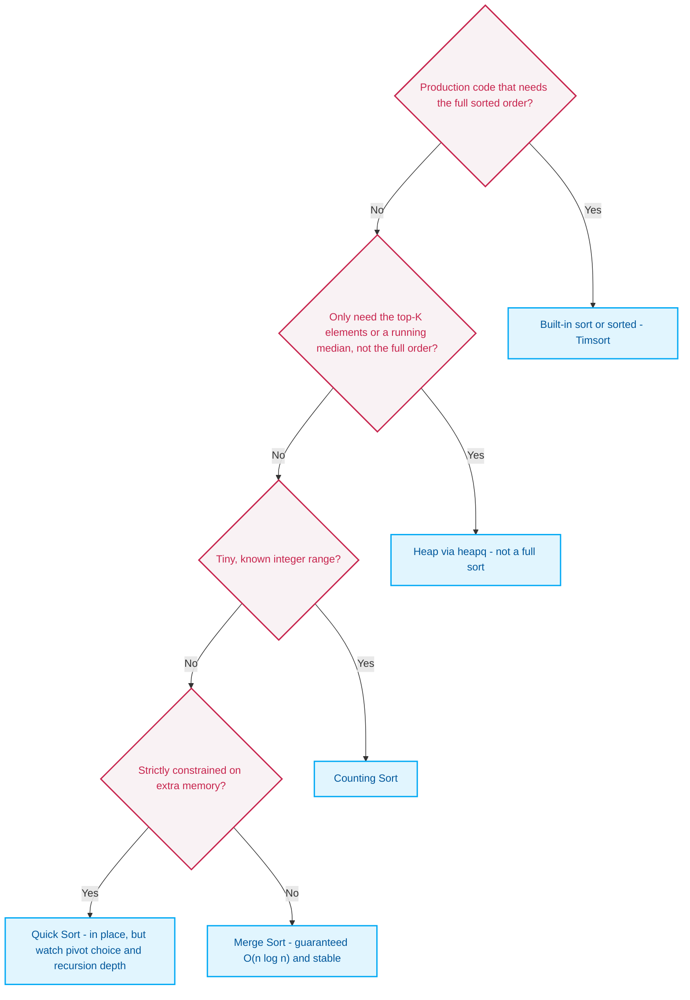
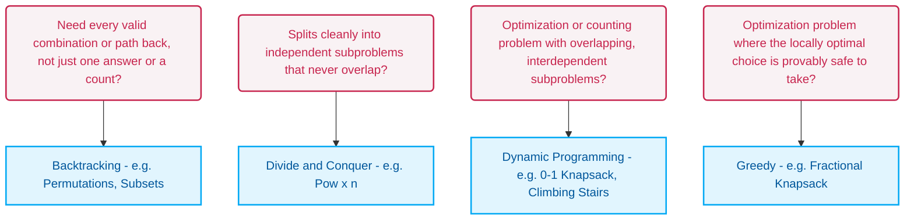

These are personal working notes on Python algorithms — a quick-recall reference for coding interviews, not a beginner's tutorial. In the AI era, I think memorizing the exact code for every algorithm matters less than actually understanding the underlying data structures and their trade-offs.

The note is in three parts: **Data Structures** (how Python represents them, and what to reach for), **Algorithms** (the general techniques and their pseudocode), and **LeetCode Examples** (the concrete problems and solutions, grouped the same way, that Parts 1 and 2 link out to).

## Reference

- Main study material: [Hello Algo](https://www.hello-algo.com/en/)
- Algorithm visualization: [Python Tutor](https://pythontutor.com/index.html)
- LeetCode problem recommendations: [krahets/LeetCode-Book](https://github.com/krahets/LeetCode-Book)

---

## Part 1: Data Structures

### Python's Basic Data Types

**Primitives:**

| Type | Example | Mutable? | Use it for |
| --- | --- | --- | --- |
| `int` | `5`, `-3` | <span class="mut-tag mut-tag--immutable">immutable</span> | Whole numbers — Python `int`s are arbitrary-precision, so no overflow to worry about (unlike fixed-width int types in other languages). |
| `float` | `3.14` | <span class="mut-tag mut-tag--immutable">immutable</span> | Anything with a fractional part, or a result of true division (`/`). |
| `str` | `"abc"` | <span class="mut-tag mut-tag--immutable">immutable</span> | Text — every "modification" makes a new string. |
| `bool` | `True`, `False` | <span class="mut-tag mut-tag--immutable">immutable</span> | Conditions and flags. Note: `bool` is technically a subclass of `int` (`True == 1`), which occasionally matters — e.g. `sum(x > 0 for x in nums)` counts truthy values. |

**Containers** — this is the one that actually matters for interview problems, since picking the wrong one changes your solution's complexity:

| Type | Ordered? | Mutable? | Duplicates? | Use it for |
| --- | --- | --- | --- | --- |
| `list` | Yes | <span class="mut-tag mut-tag--mutable">mutable</span> | Yes | The default array/stack/dynamic-sequence type. Index access, iteration order, `.append()`/`.pop()` at the end. |
| `dict` | Yes (insertion order, since 3.7) | <span class="mut-tag mut-tag--mutable">mutable</span> | Keys: no. Values: yes | Key → value lookups in `O(1)` average. The backbone of hash-table and adjacency-list problems. |
| `tuple` | Yes | <span class="mut-tag mut-tag--immutable">immutable</span> | Yes | A fixed "record" — hashable *if every element inside it is hashable* (`hash(([1], 2))` still raises `TypeError`, since the `list` inside isn't hashable), which is usually enough to make it a valid `dict` key or `set` member where a `list` can't be. |
| `set` | No | <span class="mut-tag mut-tag--mutable">mutable</span> | **No** | Membership checks (`x in s`) in `O(1)` average, and fast union/intersection/difference — the same job a `dict` does, minus the values. |

**Constructing each one:**

```python
# list
a = []                             # empty
a = [1, 2, 3]                      # literal
a = list(range(5))                 # from an iterable
a = [x**2 for x in range(5)]       # comprehension

# dict
d = {}                              # empty (this is a dict, not a set!)
d = {"a": 1, "b": 2}                # literal
d = dict(a=1, b=2)                  # from keyword args
d = dict(zip(["a", "b"], [1, 2]))   # from two iterables
d = {k: v for k, v in items}        # comprehension

# tuple
t = ()                # empty
t = (1, 2, 3)          # literal
t = 1, 2, 3            # parens are optional — the comma is what makes it a tuple
t = (1,)               # a single-element tuple needs the trailing comma; (1) is just the int 1
t = tuple([1, 2, 3])   # from an iterable

# set
s = set()               # empty (this is NOT {} — that's an empty dict)
s = {1, 2, 3}            # literal (curly braces, no colons)
s = set([1, 2, 1])       # from an iterable, deduplicated -> {1, 2}
s = {x for x in range(5)}  # comprehension
```

Four gotchas worth remembering:
- **`{}` is an empty `dict`, not an empty `set`.** The only way to get an empty set is `set()`.
- **A single-element tuple needs a trailing comma.** `(1)` evaluates to the int `1`; the comma is what actually makes something a tuple, not the parentheses (which are optional).
- **There's no "tuple comprehension."** `(x for x in range(5))` isn't a tuple — it's a *generator expression*, lazily evaluated and consumable only once. An actual tuple needs `tuple(x for x in range(5))`.
- **Postfix `if` filters; `X if cond else Y` before the `for` transforms.** Same keyword, opposite effect on length:
  ```python
  [i for i in range(6) if i % 2 == 0]
  # [0, 2, 4]  — shorter: non-matches dropped

  ['even' if i % 2 == 0 else 'odd' for i in range(6)]
  # ['even', 'odd', 'even', 'odd', 'even', 'odd']  — same length, every element kept and relabeled
  ```

### References, Copies, and Mutation

One rule explains everything below: a Python variable is just a name pointing at an object. Assignment almost always just repoints a name — it doesn't touch the object. Mutable objects can be changed in place; immutable ones can't. And whenever two names happen to point at the *same* mutable object, an in-place change made through either name shows up through both.

**Two small idioms worth knowing:**

- **Tuple swap, no temp variable:** `a, b = b, a` — the right-hand side is packed into a tuple before anything is assigned, so both values are read from their *old* state simultaneously. Same mechanism, generalized, behind the Fibonacci `a, b = b, a + b` state update and the [Reverse Linked List](#reverse-linked-list) `curr.next, prev, curr = prev, curr, curr.next` trick.
- **Tuples as hashable keys:** `(unit_price, weight)` or `(row, col)` can go straight into a `set` or as a `dict` key, as long as every element inside is itself hashable — a plain `list` never can, since Python disables hashing on it specifically.

**Reference assignment vs. shallow copy vs. deep copy** — three different amounts of separation between names:

- **`a = path`** — just a second key to the *same* room. Whoever mutates it, every key-holder sees it.
- **`a = path[:]`** — a genuinely new room, but its only "TV" is a portal back to the old room's TV. The outer container is new; anything mutable nested *inside* it is still shared.
- **`copy.deepcopy(path)`** — a new room *and* a new TV. Fully independent, all the way down.

```python
import copy

original = [1, 2, ["A", "B"]]

shallow = original[:]      # or original.copy()
deep = copy.deepcopy(original)
```

A shallow copy is enough — and cheaper — when the elements are numbers, strings, or other values with no mutable object nested anywhere inside, which is why `path[:]` was the right call in [Permutations](#permutations) (the path only ever holds `int`s). "Immutable" alone isn't enough: a `tuple` is immutable but can still hold a list (`[([1],)]`), so mutating that inner list through a shallow copy changes the original too. Once anything mutable is nested inside, only `deepcopy()` fully separates them.

**`list += ` mutates in place; `list = list + ` doesn't** — the same name-sharing trap, easy to miss because they look interchangeable:

```python
a = [1, 2]
b = a
b += [3]        # in-place — same object as append()/extend()
# a == [1, 2, 3]  (a and b still point at the same list)

c = [1, 2]
d = c
d = d + [3]      # builds a brand-new list, then repoints d to it
# c == [1, 2]     (c untouched — d points somewhere else now)
```

`+` always builds a new list; `+=` on a list calls `list.__iadd__` and mutates in place. The distinction vanishes for immutable types (`x += 1` can't mutate an `int`, so it's always a repoint) — it only bites with mutable containers.

**Mutable default arguments** are the same trap, hiding in a function signature: `def add_item(x, items=[]):` creates that `[]` **once**, at function-definition time — not per call — so every call that omits `items` shares and mutates the same list. Never default a parameter to a mutable object (`[]`, `{}`, `set()`, or any mutable instance); default to `None` and build the real value fresh inside the function body instead. Full walkthrough with both the broken and fixed versions: [Default Values & Optional Parameters](/blog/essays/python-for-frontend-engineers/#default-values--optional-parameters).

**Does it mutate? There's no universal rule — it depends on the specific API — but these hold up well in practice:**
1. **Built-in container methods that only mutate usually return `None`.** Python's convention: a method that changes an object in place has no new result to hand back. `sort()`, `append()`, `extend()`, `insert()`, `remove()`, `clear()`, `update()` all follow this. The direction matters: *mutating → usually `None`*, **not** *`None` → mutated* — `{}.get("missing")` returns `None` and changes nothing.
2. **Mutating methods that return something are the exceptions:** `.pop()` / `dict.popitem()` return the removed item, and `dict.setdefault()` returns the value it found or inserted.
3. **Don't assume a free function is safe.** `sorted(x)`, `reversed(x)`, `min(x)`, `max(x)` leave their input alone, but plenty of other functions mutate theirs and return `None` — `heapq.heapify(x)`, `heapq.heappush(heap, v)`, `random.shuffle(x)`, `bisect.insort(x, v)`. Check the docs.
4. **Immutable types (`str`, `tuple`, `int`) can never be changed in place.** A "transforming" method like `.replace()` or `.upper()` therefore returns a result instead — usually a new object, though CPython may hand back the *same* object when nothing changed (`s.strip() is s` is `True` if there's nothing to strip). Either way, the original is untouched.

One line to remember it by: *a method that only changes an object usually returns `None` — but a `None` result doesn't prove anything changed, and `.pop()`, `setdefault()` and functions like `heapify()` or `shuffle()` break the pattern, so check the docs.*

The full type-by-type comparison against TypeScript/JS — variables, truthiness, dictionaries, slicing, copying vs. pointer assignment, and more — lives in [Python for Front-End Engineers: The Big Picture](/blog/essays/python-for-frontend-engineers/#the-big-picture-python-vs-jsts). These two sections are just the interview-speed cheat sheet.

### Bitwise Tricks

Bitwise operators work on **integers** (`int`; `1.5 & 1` raises `TypeError`). Python defines them as if every `int` were an infinitely long two's-complement bit string — negative numbers have infinitely many leading `1`s — so there is no fixed width and no overflow.

| Operator | Name | What it does | Equivalent to |
| --- | --- | --- | --- |
| `&` | AND | `1` only where both bits are `1` | Set intersection; masking (extracting specific bits) |
| `\|` | OR | `1` where either bit is `1` | Set union; forcing specific bits to `1` |
| `^` | XOR | `1` where the bits differ | "Addition without carry" — the key trick for finding a single unmatched number |
| `~` | NOT | Flips every bit | `~n = -(n + 1)`; rarely used alone |
| `<<` | Left shift | Shifts left, fills with `0` | Multiply by `2^k` |
| `>>` | Right shift | Shifts right, discarding the low bits and keeping the sign | Floor-divide by `2^k` (`-3 >> 1 == -2`) |

Five patterns cover the large majority of bit-manipulation problems:

1. **XOR self-cancellation, `a ^ a = 0`.** Any number XORed with itself is `0`; XOR is commutative. XOR every element of an array together and every value that appears an even number of times cancels out — so if exactly one value appears an odd number of times, it's what's left (with several such values you'd get their XOR combined). This is the trick behind [LeetCode 136 — Single Number](https://leetcode.com/problems/single-number/), `O(1)` space.
2. **Clearing the lowest set bit, `n & (n - 1)`.** `n - 1` flips the lowest `1` bit to `0` and every bit right of it to `1`; ANDing clears exactly that bit. Used to count set bits (see [Number of 1 Bits](#number-of-1-bits)) and to check for a power of two — `n > 0 and n & (n - 1) == 0` (the `n > 0` matters, since `0` alone also satisfies the AND check).
3. **Fast parity check, `n & 1`.** The last bit's place value is `2^0`, so it directly gives odd/even — equivalent to `n % 2 != 0`, but the idiomatic form in lower-level languages.
4. **Binary search midpoint, `n >> 1`.** Right-shifting by one is floor division by 2 — `(left + right) >> 1` instead of `(left + right) // 2`.
5. **Isolating the lowest set bit, `n & -n`.** In two's complement, `-n` flips every bit of `n` and adds `1`, which leaves it sharing the *same* lowest `1` bit as `n` while inverting everything above it — ANDing the two cancels every bit except that lowest one. The classic use is the "lowbit" operation in a Fenwick Tree (Binary Indexed Tree).

**Quick reference:**

| Expression | Does |
| --- | --- |
| `n & 1` | odd/even check |
| `n & (n - 1)` | clear the lowest set bit |
| `n & -n` | isolate the lowest set bit |
| `a ^ a = 0` | XOR cancels paired elements |
| `(left + right) >> 1` | integer divide by 2 / find midpoint |

### From Types to Data Structures

Each classic data structure's actual Python representation:

| Data structure | Python representation | Key point |
| --- | --- | --- |
| Array | `list` | A `list` *is* a dynamic array. |
| Stack | `list` | `.append()` is amortized `O(1)` (an occasional resize costs `O(n)`), and `.pop()` at the end is `O(1)`. |
| Queue | [`deque`](#the-collections-toolkit) | `list.pop(0)` is `O(n)` — every remaining element shifts. `deque` gives `O(1)` at both ends. |
| Hash table / hash set | `dict` / `set` | Direct implementations of the concept. |
| Heap / priority queue | `list` + `heapq` | A heap's physical layout genuinely is just an array — see [The `collections` Toolkit](#the-collections-toolkit). |
| Graph (adjacency list) | `dict` (usually `defaultdict(list)`) | Node → list of neighbors. |
| Linked list | `ListNode` class (`val`, `next`) | LeetCode supplies `ListNode`; problems like [Reverse Linked List](#reverse-linked-list) are about rewiring `.next` pointers, which a plain `list` doesn't model. |
| Tree | `TreeNode` class (`val`, `left`, `right`) | LeetCode supplies `TreeNode`, and the tree problems here recurse over `.left`/`.right`. Any tree *can* be stored in arrays or dicts via child indices; a *complete* binary tree (like a heap) is special because children sit at computed positions `2i+1` / `2i+2`, so no extra storage is needed. |

Array, stack, hash table/set, heap, and graph all map directly onto `list`/`dict`/`set` — their cost profile already matches. Queue needs `deque` specifically for its `O(1)` head operations. Linked list and tree problems on LeetCode come with a node class (`ListNode` / `TreeNode`) and are written against its `.next` / `.left` / `.right` references — that's a convention of those problems, not a hard limit of arrays.

### The `collections` Toolkit

Python's `collections` module (plus `heapq`) is what turns the plain types above into the specific structures interview problems ask for.

**`defaultdict`** — a plain `dict` raises `KeyError` on a missing key, which normally means an `if key not in my_dict:` check before every access. `defaultdict` takes a default factory and auto-creates a value on first access instead:

```python
from collections import defaultdict

graph = defaultdict(list)
graph["A"].append("B")   # "A" didn't exist yet — defaultdict creates [] first, then appends
```

- **`defaultdict(list)`** — the standard way to build a graph adjacency list (see [Find if Path Exists in Graph](#find-if-path-exists-in-graph)).
- **`defaultdict(int)`** — missing keys default to `0`, perfect for a counter: `count_dict[key] += 1` just works.
- **`defaultdict(set)`** — missing keys default to an empty `set()`, useful when an adjacency list needs automatic deduplication.

**`Counter`** — a `dict` subclass purpose-built for frequency counting:

```python
from collections import Counter

freq = Counter("hello")
print(freq)   # Counter({'l': 2, 'h': 1, 'e': 1, 'o': 1})
```

`Counter(s) == Counter(t)` is the shortest, most readable way to compare character frequencies — see [Valid Anagram](#valid-anagram) for a benchmark showing it's often the fastest option here too, not just the shortest.

**`OrderedDict`** — before Python 3.7, dicts didn't guarantee insertion order; `OrderedDict` did, and still offers ordering operations (like `move_to_end()`) that plain `dict` doesn't. It's the classic backing structure for the **LRU Cache** problem.

**`deque` vs. `list`** — `deque` is a genuinely different data structure, not just a faster `list`. `list` is one contiguous block of memory (a row of fixed, connected seats); `deque` is a doubly-linked list of memory blocks (a line of people holding hands) — which is why they're fast at opposite ends:

| Operation | `list` | `deque` |
| --- | --- | --- |
| Tail insert/remove (`append()` / `pop()`) | amortized `O(1)` | `O(1)` |
| Head insert/remove (`insert(0, x)`/`pop(0)` vs. `appendleft(x)`/`popleft()`) | `O(n)` | `O(1)` |
| Random access by index (`arr[500]`) | `O(1)` | `O(1)` at the ends, `O(n)` in the middle |

**Rule of thumb:** index-heavy work (`nums[i]`, binary search) → `list`. Queue-shaped work (BFS, FIFO order) → `deque`. And don't use `deque` as a substitute for a hand-rolled `ListNode` chain — you can't manipulate its internal links the way [Reverse Linked List](#reverse-linked-list) needs.

**`heapq`** — historically Python's only heap was a min-heap, with no built-in max-heap. **As of Python 3.14**, `heapq` ships public `heapify_max()` / `heappush_max()` / `heappop_max()` / `heapreplace_max()` functions that do the job directly ([official docs](https://docs.python.org/3/library/heapq.html)). On anything older (still the common case in interview environments), the standard workaround is negating values on the way in and out:

```python
import heapq

nums = [1, 5, 3]
max_heap = [-x for x in nums]        # negate on the way in: [-1, -5, -3]
heapq.heapify(max_heap)              # min-heap of negated values — top is -5 (the real max, 5)
largest = -heapq.heappop(max_heap)   # negate again on the way out
```

Four more `heapq` facts worth knowing cold:

1. **Physical layout is just an array.** No `TreeNode`, no pointers — for index `i`, children live at `2i + 1` / `2i + 2`, parent at `(i - 1) // 2`.
2. **`heapify()` is `O(N)`, not `O(N log N)`.** Building a heap via repeated `heappush()` is `O(N log N)`; `heapq.heapify(nums)` in place uses a bottom-up sift-down that's provably linear. Always prefer it when a list is already in hand.
3. **`heapreplace` vs. `heappushpop` — same job, different order.** `heapreplace(heap, x)` pops the current smallest *then* pushes `x`, unconditionally. `heappushpop(heap, x)` pushes `x` first, lets it compete, *then* pops the smallest — so if `x` is itself the smallest, it goes right back out and the heap is untouched.
4. **Two heaps for a running median.** A max-heap for the smaller half of the data, a min-heap for the larger half — their tops sit at the middle of the combined data. `O(log N)` per insertion, versus re-sorting (`O(N log N)`) on every new value.

---

## Part 2: Algorithms

### Searching: The General Pattern

Two fundamentally different approaches, depending on whether the data is sorted:

**Pattern 1: Binary Search — requires a sorted array**

The soul of binary search is that every comparison eliminates half the remaining candidates. If the array is unsorted and the middle value turns out to be less than the target, there's no way to know whether the target hides in the left half or the right half — the whole "cut in half" mechanism breaks. Sortedness (non-decreasing order) is the non-negotiable precondition; duplicates are fine — the algorithm just doesn't promise *which* matching index comes back.

```python
def binary_search(nums, target):
    lo, hi = 0, len(nums) - 1
    while lo <= hi:
        mid = lo + (hi - lo) // 2      # avoids overflow in fixed-width languages
        if nums[mid] == target:
            return mid
        elif nums[mid] < target:
            lo = mid + 1
        else:
            hi = mid - 1
    return -1                          # or `lo`, for an insertion point instead
```

See [Binary Search](#binary-search) and [Search Insert Position](#search-insert-position) for the concrete LeetCode solutions (the only difference between them is what the loop returns when the target isn't found).

**In practice: the standard library already has this — `bisect`.** Same "just use the built-in" rule as sorting. `bisect.bisect_left(nums, x)` does what [Search Insert Position](#search-insert-position) asks, already written and optimized (for distinct values the two are identical; with duplicates, `bisect_left` returns the *leftmost* match while the hand-written version returns whichever match it hits first):

```python
import bisect

nums = [1, 3, 3, 3, 5]
bisect.bisect_left(nums, 3)    # 1 — first index where nums[i] >= 3  (lower bound)
bisect.bisect_right(nums, 3)   # 4 — first index where nums[i] > 3   (upper bound)
```

If `x` isn't in the list, both functions agree on the same "insertion point" that keeps it sorted. When `x` *is* present, the gap between them is useful on its own — `bisect_right(nums, x) - bisect_left(nums, x)` counts how many times `x` occurs, in `O(log n)` instead of an `O(n)` scan. One-line way to remember which is which: **`left` finds where `x` would go before its duplicates, `right` finds where it'd go after them.**

**Pattern 2: Hash Table Search — needs no sorting at all**

No matter how disordered the data is, dropping it into a Python `dict` or `set` lets the underlying hash mechanism compute a hash value and jump straight to where it lives — like a perfectly indexed parcel locker: packages don't need to be sorted by size, just hand over the pickup code (the key) and the door pops open in `O(1)`.

```python
def build_index(nums):
    return {num: i for i, num in enumerate(nums)}   # O(n) time, O(n) space — pay this once

def hash_search(index_of, target):
    return index_of.get(target, -1)                  # O(1) average per lookup, reusing the table
```

Same interface as `binary_search` above (returns the index, or `-1`), but the trade is different: `O(n)` time and space to build the table once, in exchange for dropping the sorted-input requirement and turning every *subsequent* lookup from `O(log n)` into `O(1)` average. A single one-off lookup (build + query together) is still `O(n)` overall — the win only shows up when the same table serves many queries.

### Sorting: The General Pattern

**In practice: just call the built-in.** In real engineering work, you almost never hand-write a sorting algorithm — `sort()` / `sorted()` is the right default. Python's built-in sort is **Timsort**, a C-optimized, industrial-grade algorithm combining the strengths of merge sort and insertion sort. Hand-rolling a pure-Python quicksort inside a FastAPI backend, a database-result handler, or an agent's context pipeline is longer, more bug-prone, and slower than the built-in — in a real codebase, reimplementing a standard sort is a textbook case of reinventing the wheel.

- **`list.sort()`** — in place, no new list, most memory-efficient: `nums.sort()` / `nums.sort(reverse=True)`.
- **`sorted()`** — returns a new list, leaves the original untouched, and works on any iterable (tuples, strings, even dicts by key).

**Example — the real power tool is `key`.** For anything beyond plain ascending order, `key` + a `lambda` handles custom logic in one line:

```python
nums = [-5, 2, -9, 1]
nums.sort(key=abs)                          # sort by absolute value: [1, 2, -5, -9]

words = ["apple", "bat", "cherry"]
words.sort(key=len)                         # sort by length: ['bat', 'apple', 'cherry']

intervals = [[1, 5], [2, 6], [1, 4]]
intervals.sort(key=lambda x: (x[0], -x[1])) # asc by x[0], desc by x[1] on ties: [[1,5],[1,4],[2,6]]
```

For Merge Intervals, greedy problems, and the like, `nums.sort()` is often the very first line.

**Common sorting algorithms:**

**Skip these:** Bubble Sort, Selection Sort — `O(n²)`, no practical value beyond a first-programming-class demo.

**The "big three" — know these cold (for Heap Sort, that mostly means being fluent with `heapq`):**

- **Quick Sort** — pick a pivot, then **partition**: two pointers scan the array and swap elements so everything `<= pivot` ends up on one side, everything greater on the other. Recurse on each side.

  ```python
  def quick_sort(nums, lo=0, hi=None):
      if hi is None:
          hi = len(nums) - 1
      if lo < hi:
          p = partition(nums, lo, hi)
          quick_sort(nums, lo, p - 1)
          quick_sort(nums, p + 1, hi)
      return nums

  def partition(nums, lo, hi):
      pivot = nums[hi]
      i = lo - 1                    # boundary of "elements <= pivot seen so far"
      for j in range(lo, hi):
          if nums[j] <= pivot:
              i += 1
              nums[i], nums[j] = nums[j], nums[i]
      nums[i + 1], nums[hi] = nums[hi], nums[i + 1]
      return i + 1                  # pivot's final resting index
  ```

  Average `O(n log n)`, worst case `O(n²)` (already-sorted input with a bad pivot), not stable, sorts in place. That worst case isn't just slow — this exact last-element-pivot version hits Python's default recursion limit (`RecursionError`) on a sorted input around 1,100 elements, since a bad pivot only trims one element off each call. A production implementation would pick a better pivot (e.g. median-of-three) or convert to an iterative version.

- **Merge Sort** — the textbook divide-and-conquer example, and the one to reach for whenever the problem needs **stability**:

  ```python
  def merge_sort(nums):
      if len(nums) <= 1:
          return nums
      mid = len(nums) // 2
      left = merge_sort(nums[:mid])
      right = merge_sort(nums[mid:])
      return merge(left, right)

  def merge(left, right):
      result = []
      i = j = 0
      while i < len(left) and j < len(right):
          if left[i] <= right[j]:
              result.append(left[i]); i += 1
          else:
              result.append(right[j]); j += 1
      result.extend(left[i:])
      result.extend(right[j:])
      return result
  ```

  Always `O(n log n)`, `O(n)` extra space, stable. See [Sort an Array (Merge Sort)](#sort-an-array-merge-sort) for the same code as a real LeetCode solution.

- **Heap Sort** — the code itself doesn't need memorizing; what matters is being fluent with `heapq`, since it's the universal tool for every Top-K problem (e.g. [Kth Largest Element in an Array](#kth-largest-element-in-an-array)):

  ```python
  import heapq

  def heap_sort(nums):
      heap = list(nums)                                         # copy: the pops below empty it
      heapq.heapify(heap)                                       # O(n)
      return [heapq.heappop(heap) for _ in range(len(heap))]    # O(n log n) total
  ```

**The "special weapons" — know the idea, not the code:** Counting Sort and Radix Sort don't compare elements at all, which is how they get past the `O(n log n)` floor comparison-based sorts are provably stuck at — but "past `O(n log n)`" isn't the same as a flat `O(n)`, and each has its own strict preconditions:

- **Counting Sort** — `O(n + k)`, where `k` is the size of the value range. Needs values to fall in a small, known integer range (say, 1–100); a huge range makes `k` dominate and erases the benefit.
- **Radix Sort** — `O(d · (n + b))`, where `d` is the number of digits and `b` the base. Sorts digit-by-digit (via counting sort internally), so it needs fixed-width, digit-like keys.
- **Bucket Sort** — near-linear *only* under a favorable, roughly-uniform distribution. A bad distribution (everything landing in one bucket) loses that near-linear advantage regardless, and the worst-case complexity you fall back to depends on whatever sort runs *inside* each bucket — `O(n²)` if that's insertion sort (the common textbook choice), better if it's something with a guaranteed `O(n log n)` bound.

Know *when* each applies and roughly why it's fast; you're very unlikely to be asked to hand-write one on the spot. See [Hello Algo's own bucket sort chapter](https://www.hello-algo.com/en/chapter_sorting/bucket_sort/) for the full derivation.

**Which sort to reach for** — read top to bottom and stop at the first "yes". It's a priority checklist, not a strict classification; real constraints can overlap. Click a result to jump to its explanation or code:



### Traversal (BFS and DFS): The General Pattern

Two ways to visit everything reachable from a start node, in a graph or a tree. (A tree is just a graph with no cycles, so walking it downward from the root needs no `visited` set.)

**BFS — a queue, nearest nodes first (level by level):**

```python
from collections import deque

def bfs(graph, start):
    visited = {start}
    queue = deque([start])
    while queue:
        node = queue.popleft()
        for nxt in graph[node]:
            if nxt not in visited:
                visited.add(nxt)        # mark when enqueuing, not when dequeuing
                queue.append(nxt)
```

**DFS — recursion (or an explicit stack), as deep as possible first:**

```python
def dfs(graph, node, visited):
    visited.add(node)
    for nxt in graph[node]:
        if nxt not in visited:
            dfs(graph, nxt, visited)
```

- **Which one:** BFS when you need the **fewest steps** in an unweighted graph or want to process **level by level** — the first time BFS reaches a node is along a shortest path. DFS for plain reachability, exhaustive exploration, and tree recursion; it's also the skeleton of [backtracking](#backtracking-the-general-pattern) (DFS plus an undo step).
- **Visited:** mark a node the moment it's queued (BFS) or entered (DFS), so it's never processed twice. Either way, `O(V + E)` time and `O(V)` space.
- **Python specifics:** BFS needs a `deque`, not a `list`, for `O(1)` `popleft()` (see [The `collections` Toolkit](#the-collections-toolkit)). Recursive DFS is capped by the recursion limit (about 1,000 frames by default) — on a very long path, switch to an explicit stack (`stack = [start]`, `stack.pop()`).
- **Examples:** [Binary Tree Level Order Traversal](#binary-tree-level-order-traversal) and [Find if Path Exists in Graph](#find-if-path-exists-in-graph) (BFS); [Maximum Depth of Binary Tree](#maximum-depth-of-binary-tree) and [Kth Smallest Element in a BST](#kth-smallest-element-in-a-bst) (DFS on trees).

### Choosing Between Them

Four independent identifying questions, not a strict decision tree — a real problem can brush up against more than one of these at first glance, and picking the right technique still takes judgment. Click a result to jump straight to that technique's core idea and pseudocode:



Worth being explicit about one thing the four-way split above could paper over: Greedy's real requirement is the **greedy-choice property** (the locally optimal choice is provably part of *some* globally optimal solution, and what's left is still solvable the same way) — not "subproblems overlap." Overlapping subproblems is DP's signature; a greedy algorithm typically doesn't revisit or memoize past decisions at all, since it never looks back once a choice is made. The two happen to solve similar-looking optimization problems, which is why they're easy to confuse — not because greedy is secretly a special case of "subproblems overlap."

### Divide and Conquer: The General Pattern

```text
function solve(problem):
    if problem is small enough:
        return base_case_answer(problem)
    subproblems = split(problem)
    results = [solve(sp) for sp in subproblems]
    return combine(results)
```

The recurring idea: split a big problem into independent smaller ones, solve each (recursing further if needed), then merge the results — that "merge" step is exactly what makes merge sort above a textbook divide-and-conquer algorithm. See [Pow(x, n)](#powx-n) for a concrete example (halve the exponent, reuse the subresult).

### Backtracking: The General Pattern

```text {8-10}
function backtrack(path, choices):
    if path is a complete solution:
        record(path)
        return
    for choice in choices:
        if choice is invalid given path:   # pruning
            continue
        make(choice)              # e.g. path.append(choice)
        backtrack(path, remaining_choices)
        undo(choice)              # e.g. path.pop()
```

Any problem that boils down to exhaustive enumeration is a backtracking candidate — the go-to move once brute force works is finding ways to actually prune (skip whole branches early), not just cheapen the per-step check. See [Permutations](#permutations) for the concrete example, including a case that *looks* like pruning but is really just an `O(1)` vs. `O(n)` membership-check optimization over the same search tree.

### Dynamic Programming: The General Pattern

**Why iteration beats naive recursion.** Naive recursion (top-down) recomputes the same subproblem many times over, with call-stack overhead and — for large inputs — real stack-overflow risk. Iteration (bottom-up) starts from the known base cases and builds straight up, touching each state exactly once. The Fibonacci recurrence `a, b = b, a + b` is the simplest possible example — see [Fibonacci Number](#fibonacci-number).

**What DP actually is.** Not recursion itself — DP is about **eliminating redundant work by trading space for time**: break a problem into subproblems, and remember the ones you've already solved. Three stages of the same idea:

1. **Pure recursion** (brute force) — correct, but naive Fibonacci recomputes the same subproblem exponentially many times. Whether overlap blows up depends on the recurrence itself (its branching factor and depth), so don't read this as "overlap ⇒ exponential". Independent subproblems (merge sort, `Pow(x, n)`) don't overlap at all, so there's nothing to recompute. This stage isn't DP yet.
2. **Recursion + memoization** (top-down DP) — cache each subproblem's result (a `dict`, or `@cache`) the first time it's computed.
3. **Iteration + a state table** (bottom-up DP) — the standard interview form: start from the base cases and fill a table (the `dp` array) upward, with no recursion at all.

**Terminology:** the array `dp` is the **dp table**, `dp[i]` is the subproblem solution at **state** `i`; the base-case states are the **initial states**; the recurrence itself (e.g. `dp[i] = dp[i-1] + dp[i-2]`) is the **state transition equation**. DP specifically also needs **optimal substructure** and **no aftereffect** (a state's future depends only on that state, not on how it was reached — essentially the Markov property, which is likely why basic reinforcement-learning policy methods lean on DP too). See [Choosing Between Them](#choosing-between-them) above for how this relates to divide-and-conquer, backtracking, and greedy.

**How to recognize a DP problem.** Hard to tell directly from the problem statement, so relax the check: first ask whether it fits a **decision-tree model** at all (a clear notion of sequential decisions — if so, it's backtracking-solvable at minimum). Then look for DP-specific signals:
- **In favor:** optimization language ("maximum/minimum," "most/fewest"); state representable as a list/matrix/tree with a clear recurrence between neighboring states.
- **Against:** the goal is enumerating *all* solutions, not the optimal one; clear permutation/combination character requiring multiple concrete answers back.

```text
function dp_solve(n):
    dp = array of size n + 1
    dp[base cases] = known values
    for i from first unknown state up to n:
        dp[i] = combine(dp[i - 1], dp[i - 2], ...)   # the state transition equation
    return dp[n]
```

See [Fibonacci Number](#fibonacci-number), [Climbing Stairs](#climbing-stairs), and [0-1 Knapsack](#0-1-knapsack) for concrete DP solutions.

### Greedy: The General Pattern

```text
function greedy_solve(items):
    sort items by the greedy criterion   # e.g. value per unit weight
    result = []
    for item in sorted_items:
        if item fits the remaining constraint:
            take it, update the remaining constraint
    return result
```

Greedy works by making the locally optimal decision at every stage and never looking back — which only produces the correct answer when a problem's global optimum can genuinely be assembled from local optima (see [Choosing Between Them](#choosing-between-them) above for how that compares to DP). [Fractional Knapsack](#fractional-knapsack) has that property (items are divisible, so "take the best value-per-weight first" is provably optimal); the 0-1 version does not, which is exactly why [0-1 Knapsack](#0-1-knapsack) needs DP instead.

---

## Part 3: LeetCode Examples

The concrete problems and solutions behind Parts 1 and 2, organized by topic — mostly code, with just enough notes to explain a non-obvious choice. Code is written for Python 3 (note `nonlocal` in Kth Smallest), even though the LeetCode stubs keep the older `class Solution(object)` form.

### Bitwise Operations

#### Number of 1 Bits

[LeetCode: Number of 1 Bits](https://leetcode.com/problems/number-of-1-bits/)

> Given a non-negative integer `n`, count the number of 1s in its binary representation.

**Exercise goal:** use bitwise operations — don't convert the number to a string or use a built-in that counts bits.

```python
class Solution(object):
    def hammingWeight(self, n):
        """
        :type n: int
        :rtype: int
        """
        count = 0
        while n > 0:
            n &= n - 1
            count += 1
        return count
```

Uses the "clear the lowest set bit" trick from [Bitwise Tricks](#bitwise-tricks) — each loop iteration removes exactly one `1` bit, so the iteration count is the answer.

### Arrays & Linked Lists

#### Plus One

[LeetCode: Plus One](https://leetcode.com/problems/plus-one/)

> The array `digits` stores the decimal digits of a non-negative integer left to right — `[3, 0, 8]` represents `308`, and only `[0]` itself is allowed to start with a leading zero. Simulate column addition to add `1` to the integer and return the result in the same array format; you may modify `digits` in place, and a new leading digit may make the result longer.

```python
class Solution(object):
    def plusOne(self, digits):
        """
        :type digits: List[int]
        :rtype: List[int]
        """
        for i in range(len(digits) - 1, -1, -1):
            if digits[i] < 9:
                digits[i] += 1
                return digits
            else:
                digits[i] = 0
        return [1] + digits
```

#### Reverse Linked List

[LeetCode: Reverse Linked List](https://leetcode.com/problems/reverse-linked-list/)

> Given the head of a singly linked list, reverse it and return the new head.

**Exercise goal:** reverse iteratively by rewiring pointers — don't create any new nodes.

```python
# Definition for singly-linked list.
# class ListNode(object):
#     def __init__(self, val=0, next=None):
#         self.val = val
#         self.next = next

class Solution(object):
    def reverseList(self, head):
        """
        :type head: ListNode
        :rtype: ListNode
        """
        prev = None   # nothing comes before the head yet
        curr = head    # start walking from the head

        while curr:
            temp_next = curr.next   # save the next node before curr.next gets overwritten
            curr.next = prev        # reverse the pointer
            prev = curr             # advance prev
            curr = temp_next        # advance curr
        return prev   # prev ends up on the old tail — the new head
```

**Pythonic version (tuple unpacking — see [References, Copies, and Mutation](#references-copies-and-mutation) for why this is safe):**

```python
class Solution(object):
    def reverseList(self, head):
        prev = None
        curr = head
        while curr:
            curr.next, prev, curr = prev, curr, curr.next
        return prev
```

#### Linked List Cycle

[LeetCode: Linked List Cycle](https://leetcode.com/problems/linked-list-cycle/)

> Given the head of a singly linked list, determine whether the list contains a cycle — that is, whether some node can be reached again by following `next` pointers.

**Exercise goal:** do it in `O(1)` extra space.

```python
# Definition for singly-linked list.
# class ListNode(object):
#     def __init__(self, x):
#         self.val = x
#         self.next = None

class Solution(object):
    def hasCycle(self, head):
        """
        :type head: ListNode
        :rtype: bool
        """
        slow = fast = head
        while fast and fast.next:
            slow = slow.next
            fast = fast.next.next
            if slow is fast:
                return True
        return False
```

**Floyd's tortoise and hare:** `slow` moves 1 step per round, `fast` moves 2. Either `fast` (or `fast.next`) hits `None` — no cycle — or the two meet — there is a cycle. Once both are inside the cycle, `fast` closes the gap to `slow` by exactly 1 node per round, so it can't jump over `slow` and must catch it. Compare with the `O(n)`-space alternative: store every visited node in a `set` and return `True` on a repeat.

#### Linked List Cycle II

[LeetCode: Linked List Cycle II](https://leetcode.com/problems/linked-list-cycle-ii/)

> Given the head of a singly linked list, return the node where the cycle begins, or `None` if there is no cycle. Do not modify the list.

```python
class Solution(object):
    def detectCycle(self, head):
        """
        :type head: ListNode
        :rtype: ListNode
        """
        slow = fast = head
        while fast and fast.next:
            slow = slow.next
            fast = fast.next.next
            if slow is fast:
                p = head
                while p is not slow:
                    p = p.next
                    slow = slow.next
                return p
        return None
```

**Finding the entry, in four steps:** (1) `slow` and `fast` meet inside the cycle; (2) reset one pointer to `head` and leave the other at the meeting point; (3) move both **1 step at a time**; (4) where they meet again is the cycle's entry.

**Why it works:** let `a` = steps from `head` to the entry, `b` = steps from the entry forward (along the cycle) to the meeting point, `c` = steps from the meeting point forward to the entry, and `L` = cycle length. When they meet, `slow` has walked `s = a + b + m·L` steps in total (`m` = any extra laps it made — possibly `0`, but not always: if the whole list is one cycle, `a = 0` and `slow` has already gone around once), and `fast` has walked `2s`. They're at the same node inside the cycle, so `fast` is a whole number of laps ahead: `2s − s = s = n·L`. Hence `a + b ≡ 0 (mod L)`, and since `b + c ≡ 0 (mod L)` too, `a ≡ c (mod L)` — that is, `a = k·L + c` for some whole number `k >= 0` (`a` is a step count, not a node). So a pointer from `head` takes `a` steps to reach the entry, and a pointer from the meeting point takes `a = kL + c` steps — `k` full laps back to the meeting point, then `c` more to the entry. Both land on the entry at the same moment (this also covers the case where the meeting point *is* the entry, `c = 0`).

One line to remember: **distance from `head` to the entry = distance from the meeting point to the entry, plus some whole laps.**

#### Middle of the Linked List

[LeetCode: Middle of the Linked List](https://leetcode.com/problems/middle-of-the-linked-list/)

> Given the head of a singly linked list, return the middle node. If there are two middle nodes, return the second one.

```python
class Solution(object):
    def middleNode(self, head):
        """
        :type head: ListNode
        :rtype: ListNode
        """
        slow = fast = head
        while fast and fast.next:
            slow = slow.next
            fast = fast.next.next
        return slow
```

**`fast` runs twice as far, so `slow` has gone half.** Odd length lands on the exact middle; even length lands on the *second* middle. To get the *first* middle of an even list, stop the loop one step earlier: `while fast.next and fast.next.next:`.

#### Remove Nth Node From End of List

[LeetCode: Remove Nth Node From End of List](https://leetcode.com/problems/remove-nth-node-from-end-of-list/)

> Given the head of a singly linked list, remove the `n`-th node from the end and return the head. (`1 <= n <=` list length.)

```python
# Definition for singly-linked list.
# class ListNode(object):
#     def __init__(self, val=0, next=None):
#         self.val = val
#         self.next = next

class Solution(object):
    def removeNthFromEnd(self, head, n):
        """
        :type head: ListNode
        :type n: int
        :rtype: ListNode
        """
        dummy = ListNode(0, head)
        fast = slow = dummy
        for _ in range(n):
            fast = fast.next
        while fast.next:
            fast = fast.next
            slow = slow.next
        slow.next = slow.next.next
        return dummy.next
```

**Not a speed difference this time — a fixed gap.** Send `fast` `n` steps ahead, then move both 1 step at a time; when `fast` reaches the last node, `slow` is sitting just *before* the node to delete. The `dummy` head handles the case where the node to remove is the head itself. (To just *find* the `k`-th node from the end: `fast` leads by `k`, then move both until `fast` is `None` — `slow` is the answer.)

### Two Pointers

Same-direction fast/slow pointers are covered under [Linked List Cycle](#linked-list-cycle) above. This section has two other kinds: one pointer from each end squeezing toward the middle (the palindrome problems), and a **sliding window** where both pointers move right (the last two problems).

#### Valid Palindrome

[LeetCode: Valid Palindrome](https://leetcode.com/problems/valid-palindrome/)

> Given a string `s`, return whether it is a palindrome after ignoring non-alphanumeric characters and case.

```python
class Solution(object):
    def isPalindrome(self, s):
        """
        :type s: str
        :rtype: bool
        """
        left, right = 0, len(s) - 1
        while left < right:
            while left < right and not s[left].isalnum():
                left += 1
            while left < right and not s[right].isalnum():
                right -= 1
            if s[left].lower() != s[right].lower():
                return False
            left += 1
            right -= 1
        return True
```

**Squeeze toward the middle; any unequal pair means it isn't a palindrome.** The two inner `while` loops are only the LeetCode-specific cleanup (skip punctuation); for a plain palindrome check, drop them and compare `s[left] == s[right]` directly. `O(n)` time, `O(1)` space.

#### Valid Palindrome II

[LeetCode: Valid Palindrome II](https://leetcode.com/problems/valid-palindrome-ii/)

> Given a string `s`, return whether it can become a palindrome after deleting **at most one** character.

```python
class Solution(object):
    def validPalindrome(self, s):
        """
        :type s: str
        :rtype: bool
        """
        def is_pal(l, r):
            while l < r:
                if s[l] != s[r]:
                    return False
                l += 1
                r -= 1
            return True

        left, right = 0, len(s) - 1
        while left < right:
            if s[left] != s[right]:
                return is_pal(left + 1, right) or is_pal(left, right - 1)
            left += 1
            right -= 1
        return True
```

**Same squeeze, but the first mismatch gets one chance:** skip the left character *or* the right one, and succeed if either remaining range is a palindrome. Compare the two side by side: plain palindrome — mismatch → `False`; delete-one — mismatch → skip left **or** skip right. Only the *first* mismatch needs this, since the budget is a single deletion.

#### Longest Substring Without Repeating Characters

[LeetCode: Longest Substring Without Repeating Characters](https://leetcode.com/problems/longest-substring-without-repeating-characters/)

> Given a string `s`, return the length of the longest substring that contains no repeated character.

```python
class Solution(object):
    def lengthOfLongestSubstring(self, s):
        """
        :type s: str
        :rtype: int
        """
        seen = set()
        left = 0
        best = 0
        for right, ch in enumerate(s):
            while ch in seen:           # violation: shrink until valid again
                seen.remove(s[left])
                left += 1
            seen.add(ch)
            best = max(best, right - left + 1)
        return best
```

**Sliding window, longest version: `right` expands, `left` shrinks only on a violation.** Each step grows the window by one, and only if that breaks the rule (a repeated character) does `left` advance until the window is valid again; the best length is recorded after every step. Only "is it in the window?" matters here, so a `set` is enough.

#### Minimum Size Subarray Sum

[LeetCode: Minimum Size Subarray Sum](https://leetcode.com/problems/minimum-size-subarray-sum/)

> Given an array of positive integers `nums` and a positive integer `target`, return the minimal length of a contiguous subarray whose sum is `>= target`, or `0` if none exists.

```python
class Solution(object):
    def minSubArrayLen(self, target, nums):
        """
        :type target: int
        :type nums: List[int]
        :rtype: int
        """
        left = 0
        total = 0
        best = float('inf')
        for right, x in enumerate(nums):
            total += x
            while total >= target:      # valid: record it, then try to shrink
                best = min(best, right - left + 1)
                total -= nums[left]
                left += 1
        return 0 if best == float('inf') else best
```

**Sliding window, shortest version: the moment the window qualifies, keep shrinking.** Record the length, drop `nums[left]`, and repeat while it still qualifies — that's how you find the *shortest* valid window ending at each `right`. This needs `target >= 1`: with `target <= 0` the `while` condition never fails and `left` would run past `right`.

**The sliding-window cheat sheet:**

- **Fixed window of length `k`: one in, one out.** Add `nums[right]`, subtract `nums[right - k]`, each update `O(1)`. No shrinking logic needed since the length never changes (e.g. the maximum sum of any `k` consecutive elements).
- **Variable window: `right` expands, `left` shrinks.** **Longest** valid window → shrink only on a violation. **Shortest** valid window → shrink as soon as it qualifies.
- **`set` vs. `dict`/`Counter`:** only asking "is it in the window?" → `set`. Need *how many times* (e.g. "at most 2 distinct characters") → `Counter`, and `del count[x]` when it hits `0` — a `Counter` keeps zero-count keys, so without the `del`, `len(count)` would overcount the distinct elements.
- **Why it's `O(n)` despite the nested loop:** `left` and `right` each only ever move right, at most `n` steps apiece, never backwards.
- **Needs monotonicity:** with non-negative numbers, expanding never lowers the sum and shrinking never raises it, so you always know which pointer to move. Negative numbers break that, and the plain sum-based window stops working.

### Stacks and Queues

#### Valid Parentheses

[LeetCode: Valid Parentheses](https://leetcode.com/problems/valid-parentheses/)

> Given a string `s` containing only `()`, `[]`, and `{}`, determine whether it's valid. Every closing bracket must match the type of the most recently unmatched opening bracket, and no unmatched opening bracket may remain at the end.

**Exercise goal:** use a stack.

```python
class Solution(object):
    def isValid(self, s):
        """
        :type s: str
        :rtype: bool
        """
        stack = []
        mapping = {")": "(", "]": "[", "}": "{"}
        for char in s:
            if char in mapping:
                top_element = stack.pop() if stack else '#'
                if mapping[char] != top_element:
                    return False
            else:
                stack.append(char)
        return not stack
```

### Hash Tables

#### Valid Anagram

[LeetCode: Valid Anagram](https://leetcode.com/problems/valid-anagram/)

> Given two lowercase strings `s` and `t`, determine whether `s`'s characters can be rearranged to form `t` (no characters added, removed, or replaced).

**Exercise goal:** count letters with a hash table — don't sort the strings.

```python
class Solution(object):
    def isAnagram(self, s, t):
        """
        :type s: str
        :type t: str
        :rtype: bool
        """
        if len(s) != len(t):
            return False
        s_dict = {}
        t_dict = {}

        for s_temp in s:
            if s_temp in s_dict:
                s_dict[s_temp] += 1
            else:
                s_dict[s_temp] = 1

        for t_temp in t:
            if t_temp in t_dict:
                t_dict[t_temp] += 1
            else:
                t_dict[t_temp] = 1

        return s_dict == t_dict
```

**Pythonic version (`Counter`):**

```python
from collections import Counter

class Solution(object):
    def isAnagram(self, s, t):
        return Counter(s) == Counter(t)
```

**Why is `Counter` often faster here, not slower?** It routes string counting through a C-accelerated fast path (`collections._count_elements`), which comfortably beats a Python-level loop — including the fixed-size array below. Benchmarked on 26,000-character strings (100 reps each): `Counter` fastest, the array slowest, the hand-written `dict` loop in between. (LeetCode's own submission timings carry real server noise too, so a few milliseconds' difference between two `O(n)` solutions there often isn't a meaningful signal either way.)

```python
class Solution(object):
    def isAnagram(self, s, t):
        if len(s) != len(t):
            return False

        counts = [0] * 26
        for i in range(len(s)):
            counts[ord(s[i]) - ord('a')] += 1
            counts[ord(t[i]) - ord('a')] -= 1

        return all(count == 0 for count in counts)
```

`Counter(s) == Counter(t)` is still the right call for everyday code — shortest, most readable, and the fastest in the benchmark above. The array isn't smaller in Big-O terms either: since both strings are constrained to lowercase letters, `dict`/`Counter` can never hold more than 26 keys, so all three implementations use `O(1)` auxiliary space in this specific problem — the array's real advantage is a smaller, more predictable *constant* (26 plain ints vs. a hash table's per-entry overhead), not an asymptotic one. Treat any speed claim between these three as something to benchmark in your actual environment, not something to assume from the big-O alone.

### Trees

#### Maximum Depth of Binary Tree

[LeetCode: Maximum Depth of Binary Tree](https://leetcode.com/problems/maximum-depth-of-binary-tree/)

> Given the root of a binary tree, return its maximum depth — the number of nodes along the longest path from the root to a leaf. An empty tree has depth `0`.

**Exercise goal:** use recursion.

**Note:** this problem counts depth by *nodes*, not edges — a tree with just a root node has depth `1`. Worth flagging because tree height/depth is more commonly defined by edge count by default (a single node has height `0`) — always check which convention a given problem is using.

```python
# Definition for a binary tree node.
# class TreeNode(object):
#     def __init__(self, val=0, left=None, right=None):
#         self.val = val
#         self.left = left
#         self.right = right
class Solution(object):
    def maxDepth(self, root):
        """
        :type root: Optional[TreeNode]
        :rtype: int
        """
        if root is None:
            return 0
        left_depth = self.maxDepth(root.left)
        right_depth = self.maxDepth(root.right)
        return max(left_depth, right_depth) + 1
```

#### Binary Tree Level Order Traversal

[LeetCode: Binary Tree Level Order Traversal](https://leetcode.com/problems/binary-tree-level-order-traversal/)

> Given the root of a binary tree, visit all nodes level by level — top to bottom, left to right within each level. Return a 2D array, one subarray of values per level. An empty tree returns an empty array.

**Exercise goal:** use a queue (BFS — see [Traversal](#traversal-bfs-and-dfs-the-general-pattern)).

```python
from collections import deque

# Definition for a binary tree node.
# class TreeNode(object):
#     def __init__(self, val=0, left=None, right=None):
#         self.val = val
#         self.left = left
#         self.right = right
class Solution(object):
    def levelOrder(self, root):
        """
        :type root: Optional[TreeNode]
        :rtype: List[List[int]]
        """
        if not root:
            return []
        queue = deque([root])
        res = []
        while queue:
            level_size = len(queue)
            current_level = []
            for _ in range(level_size):
                node = queue.popleft()
                current_level.append(node.val)
                if node.left:
                    queue.append(node.left)
                if node.right:
                    queue.append(node.right)
            res.append(current_level)
        return res
```

#### Kth Smallest Element in a BST

[LeetCode: Kth Smallest Element in a BST](https://leetcode.com/problems/kth-smallest-element-in-a-bst/)

> Given the root of a BST with `n` nodes holding distinct values (positions numbered 1 through `n` in ascending order) and an integer `k` (`1 <= k <= n`), return the value at position `k`.

**Exercise goal:** find it directly during an inorder traversal rather than collecting every value first.

Inorder traversal of a BST visits nodes in ascending order — that's what makes "count as you go and stop at the k-th one" correct here, and it avoids collecting the whole list first.

```python
# Definition for a binary tree node.
# class TreeNode(object):
#     def __init__(self, val=0, left=None, right=None):
#         self.val = val
#         self.left = left
#         self.right = right
class Solution(object):
    def kthSmallest(self, root, k):
        """
        :type root: Optional[TreeNode]
        :type k: int
        :rtype: int
        """
        count = 0
        res = None

        def inorder(node):
            nonlocal count, res
            if not node or res is not None:
                return
            inorder(node.left)
            count += 1
            if count == k:
                res = node.val
                return
            inorder(node.right)

        inorder(root)
        return res
```

(`count`/`res` are local variables closed over by `inorder`, not instance state — that way, calling `kthSmallest` twice on the same `Solution` object still gives correct results each time.)

### Heaps

#### Kth Largest Element in an Array

[LeetCode: Kth Largest Element in an Array](https://leetcode.com/problems/kth-largest-element-in-an-array/)

> Given an integer array `nums` and an integer `k` (`1 <= k <= n`, where `n` is the array's length), return the element that would appear at position `k` if the array were sorted from largest to smallest. Count duplicates separately — e.g. the 2nd-largest element of `[5, 5, 2]` is still `5`.

**Exercise goal:** use a min-heap holding no more than `k` elements.

```python
import heapq

class Solution(object):
    def findKthLargest(self, nums, k):
        """
        :type nums: List[int]
        :type k: int
        :rtype: int
        """
        heap = nums[:k]
        heapq.heapify(heap)

        for i in range(k, len(nums)):    # index loop: no copy of nums[k:]
            if nums[i] > heap[0]:
                heapq.heapreplace(heap, nums[i])
        return heap[0]
```

The heap holds the `k` largest values seen so far; its top (`heap[0]`) is the smallest of those `k` — which is exactly the `k`-th largest overall. Extra space is `O(k)` — which is why the loop walks `nums` by index instead of slicing `nums[k:]`, since a slice would copy the rest of the list and bring the extra space back up to `O(n)`. See [The `collections` Toolkit](#the-collections-toolkit) for why `heapreplace` (not `heappush` + `heappop`) is the right call here.

### Graphs

#### Find if Path Exists in Graph

[LeetCode: Find if Path Exists in Graph](https://leetcode.com/problems/find-if-path-exists-in-graph/)

> An undirected graph has `n` vertices labeled `0` to `n - 1`; the array `edges` lists each undirected connection as `[u, v]`. Given a `source` and `destination` vertex, determine whether a path exists between them. The graph may contain cycles and may be disconnected.

**Exercise goal:** build an adjacency list from `edges`, then use BFS or DFS (see [Traversal](#traversal-bfs-and-dfs-the-general-pattern)).

```python
from collections import defaultdict, deque

class Solution(object):
    def validPath(self, n, edges, source, destination):
        """
        :type n: int
        :type edges: List[List[int]]
        :type source: int
        :type destination: int
        :rtype: bool
        """
        if source == destination:
            return True

        graph = defaultdict(list)
        for u, v in edges:
            graph[u].append(v)
            graph[v].append(u)

        queue = deque([source])
        visited = set([source])

        while queue:
            curr = queue.popleft()
            if curr == destination:
                return True
            for neighbor in graph[curr]:
                if neighbor not in visited:
                    visited.add(neighbor)
                    queue.append(neighbor)

        return False
```

`defaultdict(list)` for the adjacency list, `deque` for the BFS queue — see [The `collections` Toolkit](#the-collections-toolkit) for why each is the right choice here (in particular, why a plain `list` would make the BFS queue slow), and [Traversal](#traversal-bfs-and-dfs-the-general-pattern) for the pattern itself.

### Searching

#### Binary Search

[LeetCode: Binary Search](https://leetcode.com/problems/binary-search/)

> Given an integer array `nums` sorted in strictly increasing order and a `target` value, find `target` — return its index if present, otherwise `-1`.

**Exercise goal:** use binary search.

```python
class Solution(object):
    def search(self, nums, target):
        """
        :type nums: List[int]
        :type target: int
        :rtype: int
        """
        i = 0
        j = len(nums) - 1
        while i <= j:
            mid = i + (j - i) // 2
            if target > nums[mid]:
                i = mid + 1
            elif target < nums[mid]:
                j = mid - 1
            else:
                return mid
        return -1
```

#### Search Insert Position

[LeetCode: Search Insert Position](https://leetcode.com/problems/search-insert-position/)

> Given an integer array `nums` sorted in strictly increasing order and a `target` value, return its index if `target` is found, otherwise the index where it could be inserted to keep the array sorted.

**Exercise goal:** use binary search.

```python
class Solution(object):
    def searchInsert(self, nums, target):
        """
        :type nums: List[int]
        :type target: int
        :rtype: int
        """
        i = 0
        j = len(nums) - 1
        while i <= j:
            mid = i + (j - i) // 2
            if nums[mid] > target:
                j = mid - 1
            elif nums[mid] < target:
                i = mid + 1
            else:
                return mid
        return i
```

Identical to [Binary Search](#binary-search) above except for what happens on a miss — see [Searching: The General Pattern](#searching-the-general-pattern).

### Sorting

#### Sort an Array (Merge Sort)

[LeetCode: Sort an Array](https://leetcode.com/problems/sort-an-array/)

> Given an integer array `nums`, return it sorted in non-decreasing order.

**Exercise goal:** implement merge sort yourself — no calling the language's built-in sort.

```python
class Solution(object):
    def sortArray(self, nums):
        """
        :type nums: List[int]
        :rtype: List[int]
        """
        if len(nums) <= 1:
            return nums
        mid = len(nums) // 2
        left_half = self.sortArray(nums[:mid])
        right_half = self.sortArray(nums[mid:])
        return self.merge(left_half, right_half)

    def merge(self, left, right):
        res = []
        i = 0
        j = 0
        while i < len(left) and j < len(right):
            if left[i] <= right[j]:
                res.append(left[i])
                i += 1
            else:
                res.append(right[j])
                j += 1
        res.extend(left[i:])
        res.extend(right[j:])
        return res
```

### Divide and Conquer

#### Pow(x, n)

[LeetCode: Pow(x, n)](https://leetcode.com/problems/powx-n/)

> Given a real number `x` and an integer `n`, calculate `x^n`. `x^0` is defined as `1`, including when `x = 0`. When `n < 0`, `x != 0` is guaranteed, and the answer can be computed as `1 / x^(-n)`.

**Exercise goal:** don't use the built-in power function — practice recursive divide and conquer, halving the exponent each step and reusing the already-computed subproblem result.

```python
class Solution(object):
    def myPow(self, x, n):
        """
        :type x: float
        :type n: int
        :rtype: float
        """
        if n < 0:
            x = 1 / x
            n = -n

        if n == 0:
            return 1.0

        half = self.myPow(x, n // 2)

        if n % 2 == 0:
            return half * half
        else:
            return half * half * x
```

Halving the exponent each call means both the recursion depth and the total work are `O(log n)`.

**Worth noting:** this problem doesn't actually forbid the language's own power operator — so on LeetCode itself, the one-liner below is also a valid, accepted submission. The recursive version above is what you'd write in an interview to actually demonstrate the divide-and-conquer technique.

```python
class Solution(object):
    def myPow(self, x, n):
        """
        :type x: float
        :type n: int
        :rtype: float
        """
        return x ** n
```

### Backtracking

#### Permutations

[LeetCode: Permutations](https://leetcode.com/problems/permutations/)

> Given an array `nums` of distinct integers with at least one element, return all possible permutations (in any order), using each element exactly once.

**Exercise goal:** solve it with backtracking, using a boolean array to track which positions are already used in the current permutation. That's version 2 below; version 1 is the simpler starting point.

**1. Simple version (`O(n)` membership check)**

```python
class Solution(object):
    def permute(self, nums):
        """
        :type nums: List[int]
        :rtype: List[List[int]]
        """
        res = []
        def backtrack(path):
            if len(path) == len(nums):
                res.append(path[:])   # shallow copy — fine here since the elements are ints
                return
            for num in nums:
                if num in path:
                    continue
                path.append(num)
                backtrack(path)
                path.pop()
        backtrack([])
        return res
```

**2. Optimized version (`O(1)` used-check via a boolean array)**

```python
class Solution(object):
    def permute(self, nums):
        """
        :type nums: List[int]
        :rtype: List[List[int]]
        """
        res = []
        used = [False] * len(nums)
        def backtrack(path):
            if len(path) == len(nums):
                res.append(path[:])   # shallow copy — fine here since the elements are ints
                return
            for i in range(len(nums)):
                if used[i]:
                    continue
                path.append(nums[i])
                used[i] = True
                backtrack(path)
                path.pop()
                used[i] = False
        backtrack([])
        return res
```

Both versions explore the exact same search tree — the second just swaps the `O(n)` `num in path` list scan for an `O(1)` `used[i]` array lookup. Real pruning (skipping whole branches, e.g. for duplicate values) is a different, further optimization on top of this.

### Dynamic Programming

#### Fibonacci Number

The first programming exercise in the book.

[LeetCode: Fibonacci Number](https://leetcode.com/problems/fibonacci-number/)

> The Fibonacci sequence is defined by `F(0) = 0`, `F(1) = 1`, and, for `n >= 2`, `F(n) = F(n - 1) + F(n - 2)`.
>
> Given a non-negative integer `n`, calculate and return `F(n)`.

**Exercise goal:** use a loop, not recursion — so version 2 below is the intended answer. Version 1 is shown first only for comparison.

**1. Recursive (naive, top-down)**

```python
class Solution(object):
    def fib(self, n):
        if n == 0:
            return 0
        elif n == 1:
            return 1
        else:
            return self.fib(n - 1) + self.fib(n - 2)
```

**2. Iterative (Pythonic, bottom-up)**

```python
class Solution(object):
    def fib(self, n):
        if n <= 1:
            return n

        a, b = 0, 1
        for _ in range(2, n + 1):
            a, b = b, a + b

        return b
```

As the book puts it: *"Only the previous two terms are needed to calculate the next term; there is no need to store the entire sequence."* That's why the iterative version runs in `O(1)` space. See [Dynamic Programming: The General Pattern](#dynamic-programming-the-general-pattern) for why this beats the naive recursive version, and what makes it "DP" rather than just "a loop."

#### Climbing Stairs

[LeetCode: Climbing Stairs](https://leetcode.com/problems/climbing-stairs/)

> A staircase has `n` steps; each move climbs 1 or 2 steps, and you must land exactly on step `n`. Count the number of distinct ways to reach the top (`n >= 1`; ways differ only in their sequence of 1-step/2-step moves).

**Exercise goal:** first solve it with a plain 1D DP array; the two-variable space optimization comes as the follow-up below.

```python
class Solution(object):
    def climbStairs(self, n):
        """
        :type n: int
        :rtype: int
        """
        # handle the base cases
        if n <= 2:
            return n

        dp = [0] * (n + 1)

        # seed the initial states
        dp[1] = 1
        dp[2] = 2

        for i in range(3, n + 1):
            dp[i] = dp[i - 1] + dp[i - 2]

        return dp[n]
```

**Space-optimized version** — only the last two states ever matter, same `a, b = b, a + b` idea as [Fibonacci Number](#fibonacci-number) above:

```python
class Solution(object):
    def climbStairs(self, n):
        """
        :type n: int
        :rtype: int
        """
        if n <= 2:
            return n
        a = 1
        b = 2
        for _ in range(3, n + 1):
            current = a + b
            a = b
            b = current
        return b
```

#### 0-1 Knapsack

A classic DP exercise from the Hello Algo book (not a standalone LeetCode problem): given equal-length arrays `wgt` and `val`, where item `i` has positive weight `wgt[i]` and non-negative value `val[i]`, and a knapsack of non-negative capacity `cap`. Each item may be selected at most once. Find the maximum total value that fits without exceeding `cap`.

**Exercise goal:** use one-dimensional DP.

```python
class Solution(object):
    def knapsack(self, wgt, val, cap):
        """
        :type wgt: List[int]
        :type val: List[int]
        :type cap: int
        :rtype: int
        """
        dp = [0] * (cap + 1)

        for i in range(len(wgt)):
            w = wgt[i]
            v = val[i]

            for c in range(cap, w - 1, -1):
                dp[c] = max(dp[c], dp[c - w] + v)

        return dp[cap]
```

**Why iterate `c` backwards?** This is the one detail in the code that's more worth remembering than the template itself. `dp[c - w]` needs to refer to the state *before item `i` was considered* — i.e., last round's value. Iterating `c` downward guarantees that when `dp[c]` is updated, `dp[c - w]` (a smaller index, not yet touched this round) still holds last round's value. Iterate upward instead, and `dp[c - w]` could already include item `i` from earlier in the *same* pass — which lets the loop pick item `i` more than once, silently turning this into the *unbounded* knapsack problem instead of 0-1. (Example: a single item of weight 3, value 10, capacity 9 gives `10` iterating backward — correct — and `30` iterating forward, i.e. item `i` taken three times.)

### Greedy

#### Fractional Knapsack

Another Hello Algo book exercise (no LeetCode link): same setup as [0-1 Knapsack](#0-1-knapsack) (`wgt[i] > 0`, `val[i] >= 0`, capacity `cap >= 0`), except each item can be split — any fraction of an item may go into the knapsack, with value gained proportional to the fraction taken. Return the maximum total value as a float.

**Exercise goal:** solve it with a greedy algorithm.

```python
class Solution(object):
    def fractionalKnapsack(self, wgt, val, cap):
        """
        :type wgt: List[int]
        :type val: List[int]
        :type cap: int
        :rtype: float
        """
        items = []
        for i in range(len(wgt)):
            unit_price = float(val[i]) / wgt[i]
            items.append((unit_price, wgt[i], val[i]))

        items.sort(key=lambda x: x[0], reverse=True)

        total_value = 0.0

        for unit_price, w, v in items:
            if cap >= w:
                cap -= w
                total_value += v
            else:
                total_value += unit_price * cap
                break

        return total_value
```

Sorts by value-per-unit-weight (descending), then greedily takes as much of the best item as capacity allows — see [Greedy: The General Pattern](#greedy-the-general-pattern) for why this works here but wouldn't for the 0-1 version.
